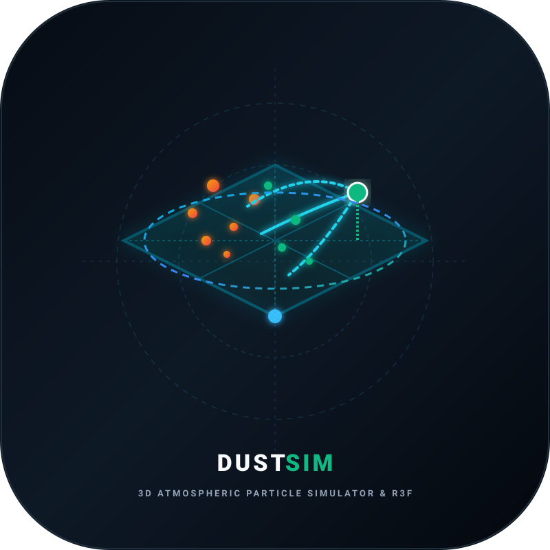

<p align="center">
  
</p>

<h1 align="center">DustSim</h1>

<p align="center">
  <strong>Interactive 3D Atmospheric Particle Transport Simulator &amp; Proactive Mist Suppression Autopilot in React Three Fiber.</strong>
</p>

<p align="center">
  <a href="LICENSE"></a>
  
  
  
  <a href="future.md"></a>
</p>

---

## ⚡ Overview

**DustSim** is a high-fidelity, edge-native 3D physics simulator and active mitigation engine designed to minimize particulate pollution on industrial construction sites.

By fusing real-time wind vectors, humidity data, and spatial particulate concentration metrics (PM2.5 and PM10), the simulator runs a proactive autopilot that pre-wets target sectors with high-pressure water mist sprinklers to intercept and suppress incoming dust plumes *before* air quality breaches critical thresholds.

---

## 🏗️ Physical & Analytical Architecture

DustSim couples a high-performance 3D WebGL particle simulator with a rule-based predictive actuation loop:

```mermaid
flowchart TD
    subgraph Env [Atmospheric Physics Engine]
        A["Wind Vectors (Angle, Speed)"] -->|Brownian Motion Drift| B["Particulate Transport Loop"]
        C["Humidity Levels"] -->|Evaporation/Settling Rate| B
    end
    
    subgraph Visualizer [3D WebGL Render Core]
        B -->|THREE.Points Particles| D["React Three Fiber Canvas"]
        E["Physical Sprinklers (SprayDroplets)"] -->|Fluid Dynamics Mist| D
        F["Deployed Sensor Node Pins"] -->|Visual Health Badges| D
    end
    
    subgraph Brain [System Autopilot Core]
        D -->|Real-Time Telemetry Poll| G["Predictive Actuation Controller"]
        G -->|30-Min Wind-Adjusted Forecast| H["Autopilot Sprinkler Dispatch"]
        H -->|Mitigation State (0% - 100%)| E
    end
```

---

## ⚡ Core Engineering Pillars

*   **Tri-Modal Physics Simulation:** Simulates floating dust particles using custom WebGL shaders (`THREE.Points`) drifted dynamically by real-time variable wind angles and speed vectors.
*   **Proactive Pre-Wetting Autopilot:** Rather than waiting for a particulate threshold breach, the system evaluates forward forecasts. If PM levels are projected to spike, the autopilot triggers pre-wetting at 60% mist capacity.
*   **High-Fidelity Fluid Mist Spray:** Renders realistic high-pressure water spray particles (`SprayDroplets`) that arc gracefully under simulated gravity and splash onto active construction sectors.
*   **Live Spatial Telemetry Dashboard:** Glassmorphic UI featuring active sensor feeds, real-time variance charts, and automated CSV logging.

---

## 📊 Mitigation States & Actuation Loops

```text
  Air Quality Metrics (PM2.5 + PM10 + Wind Speed)
       │
       ├──► [PM2.5 <= 40]                                ==► NORMAL State (Standby mode)
       ├──► [PM2.5 > 40]   + [30m Forecast <= 75]        ==► MONITOR State (Elevated polling)
       ├──► [PM2.5 <= 90]  + [30m Forecast > 75]         ==► PREDICTIVE ACTUATION State (60% Mist output)
       └──► [PM2.5 > 90]                                 ==► FULL MITIGATION State (100% Mist output)
```

---

## 🚀 Quick Start (Under 60 Seconds)

### 1. Install Dependencies
```bash
git clone https://github.com/seeramsujay/dust-sim.git
cd dust-sim
npm install
```

### 2. Launch Development Server
```bash
npm run dev
```

### 3. Deploy & Monitor
Open [http://localhost:5173/](http://localhost:5173/) to interact with the 3D dashboard:
*   **Deploy Sensor:** Dynamically provision and pin a new sensor node anywhere on the spatial 3D grid.
*   **Interactive Orbit Controls:** Left-click and drag to rotate the factory floor, right-click to pan, and scroll to zoom.
*   **Export Analytics:** Download the active run's sensor history as a CSV file.

---

## 🔮 Engineering Roadmap

To explore planned features including WebGPU compute shader acceleration, CityGML 3D digital twin terrain ingestion, and reinforcement learning water conservation, read [future.md](future.md).

---

## 📄 License

Distributed under the **MIT License**. See `LICENSE` for details.
